# WDT

Fridolin's Wonderous Dungeon Toolkit

# Workflow Setup

## Overview

This repository uses an automated CI/CD pipeline built on Gitea Actions. The pipeline ensures every change is built and scanned for vulnerabilities before it can reach the registry — and nothing is published until it has been reviewed and merged to `main`.

---

## Developer workflow

### 1. Create a feature branch

Checkout a new branch from `main` and make your changes. If anything under `dockerbuild/` or `.gitea/workflows/` is modified and pushed, the pipeline will automatically trigger a Docker build and a Trivy vulnerability scan.

> The image is **not** pushed to the registry at this stage. The build exists solely to verify that your changes compile cleanly and pass the security scan.

### 2. Open a pull request

Before opening a PR, confirm that the build on your feature branch has passed — this is a required status check and the PR **cannot be merged** while it is failing.

Additionally, every PR requires **at least one approval** from another team member before it can be merged.

### 3. Merge to main

Once the PR is approved and all checks are green, merging to `main` triggers the full release pipeline:

1. Docker image is built
2. Trivy scan runs (HIGH and CRITICAL findings will fail the pipeline)
3. The next semantic version tag is calculated (`patch` is incremented automatically)
4. The image is tagged and pushed to the registry
5. A matching git tag is created and pushed to the repository

---

## Repository structure

```
.
├── dockerbuild/
│   ├── Dockerfile        # your image definition
│   └── src/              # scripts and source files for the build
└── .gitea/
    └── workflows/
        ├── on-merge.yaml                  # trigger: PR merged → main
        ├── on-push.yaml                   # trigger: push to feature branch
        ├── template_build-scan.yaml       # reusable: build + scan
        └── template_build-scan-push.yaml  # reusable: build + scan + push + tag
```

---

## Pipeline diagram


